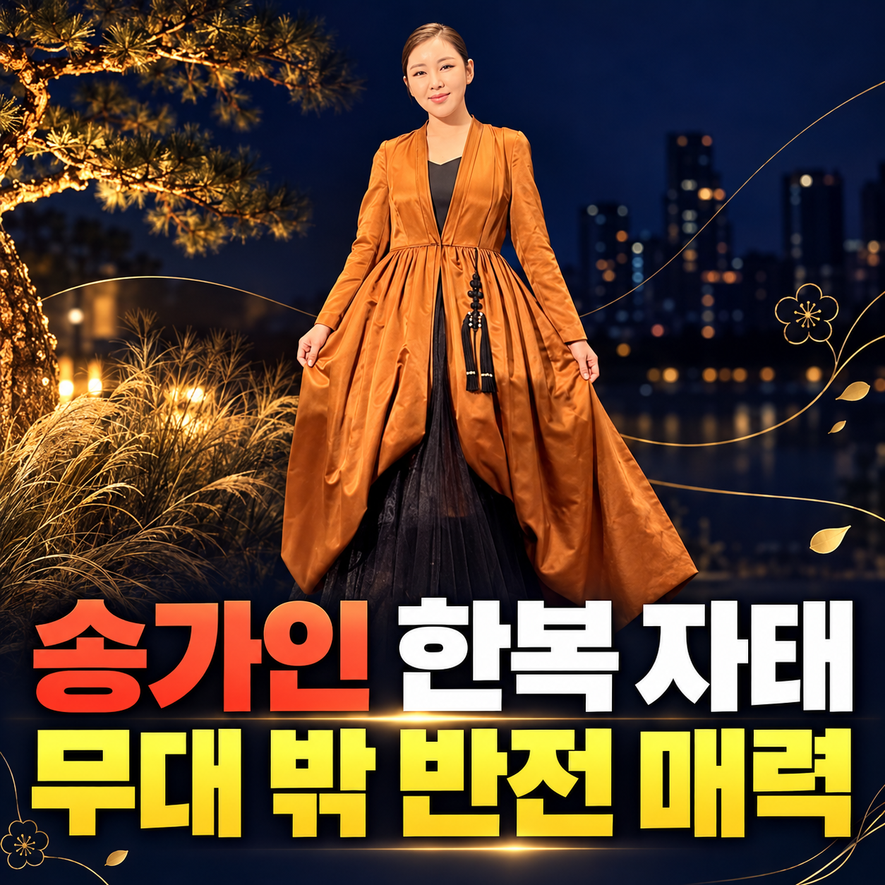

# 미발행 원고 썸네일 4종

[전체 PNG와 출처 설명 ZIP 받기](https://github.com/okcallpang-gif/push-images/raw/refs/heads/main/blog-drafts/2026-10-23/unpublished-thumbnails.zip)

공개 사진을 참고해 AI로 제작·편집한 썸네일입니다. 새로 촬영된 보도 사진이 아닙니다.

## A2 · 황윤성

황윤성의 선곡 / 이찬원 노래였다! / 메밀꽃 필 무렵

[PNG 다운로드](https://github.com/okcallpang-gif/push-images/raw/refs/heads/main/blog-drafts/2026-10-23/A2/thumbnail.png)

황윤성 관련 AI 제작·편집 썸네일 · 참고 사진 출처: MBN 홈페이지

## A3 · 구수경

구수경 신곡 / 유현상이 만들었다! / 그 이름 어머니

[PNG 다운로드](https://github.com/okcallpang-gif/push-images/raw/refs/heads/main/blog-drafts/2026-10-23/A3/thumbnail.png)

구수경 관련 AI 제작·편집 썸네일 · 참고 사진 출처: MBN 홈페이지

## B1 · 송가인

송가인 한복 자태 / 무대 밖 반전 매력

[PNG 다운로드](https://github.com/okcallpang-gif/push-images/raw/refs/heads/main/blog-drafts/2026-10-23/B1/thumbnail.png)

송가인 관련 AI 제작·편집 썸네일 · 참고 사진 출처: 송가인 공식 인스타그램·스포츠월드 홈페이지

## B2 · 장한별

장한별 신곡 미야 / 첫 단독콘서트까지!

[PNG 다운로드](https://github.com/okcallpang-gif/push-images/raw/refs/heads/main/blog-drafts/2026-10-23/B2/thumbnail.png)

장한별 관련 AI 제작·편집 썸네일 · 참고 사진 출처: MBN 홈페이지

